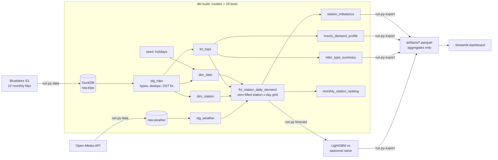

# Boston Bluebikes Demand Warehouse & Forecast

**4.57 million Boston bike-share trips modeled into a tested star-schema warehouse with dbt and
DuckDB. On top of it: a station-level demand forecast that cuts error 41% vs. a seasonal-naive
baseline (11% without weather data), and a dashboard showing where bikes pile up and where they
run out.**

> **Live demo:** https://boston-bluebikes-demand.streamlit.app (free tier: if it's asleep, click
> "wake up" and give it ~30 s) · Run it locally: `python run.py app`

## Results at a glance

| | Value |
|---|---|
| Trips modeled (Oct 2025 – Sep 2026) | **4,573,459** across **628** stations |
| dbt project | **10 models** (staging → marts → analytics) and **29 data tests**, all passing |
| Data issues caught by tests | 81 duplicate trips, 51 negative durations from daylight saving, 3,060 trips > 24 h (flagged) |
| Next-day forecast, 20 busiest stations, held-out Aug–Sep 2026 | **MAE 20.5 vs. 34.6** trips/day for seasonal naive (**−40.8%**) |
| Same model without weather features | MAE 30.8 (**−11.0%**), the gain achievable with no weather information |

The full model uses the *observed* weather on the forecast day as a stand-in for a weather
forecast, so −40.8% is an upper bound. See [Limitations](#limitations).

## Why this matters

Bike-share systems constantly redistribute bikes by truck. If a station empties during the morning
commute, riders walk away; if it fills, nobody can return a bike. Knowing **which stations drain or
fill, and how many departures to expect tomorrow**, is what rebalancing crews plan around. This
project builds the analytics foundation for that (a warehouse with tested, documented models) and
then a forecast on top of it.

## Data

| Source | What | License / terms |
|---|---|---|
| [Bluebikes system data](https://bluebikes.com/system-data) | 12 monthly trip files, Oct 2025 – Sep 2026 (297 MB) | [Bluebikes Data License](https://bluebikes.com/data-license-agreement): non-commercial analysis allowed; **raw data may not be redistributed**, so it is downloaded by script and never committed |
| [Open-Meteo](https://open-meteo.com/) historical API | Daily weather at Boston Logan (temperature, precipitation, snow, wind) | [CC BY 4.0](https://open-meteo.com/en/licence), weather data by Open-Meteo.com |
| Holiday seed | 13 US/Massachusetts holidays (incl. Patriots Day) | Written by hand |

The repo only contains **aggregated** tables (`artifacts/`, about 100 KB) for the dashboard. No
trip-level rows are included. This is an independent student project, not affiliated with or
endorsed by Bluebikes, Lyft, or any municipality.

## Architecture



### Warehouse design (star schema)

- **Staging:** `stg_trips` casts raw text to types, removes 81 duplicate `ride_id`s, restricts to
  the study window, and fixes daylight-saving durations (below). `stg_weather` renames and types.
- **Dimensions:** `dim_station` (name = most frequent label; location = median of reported
  coordinates), `dim_date` (weekday, weekend, holiday, season).
- **Facts:** `fct_trips` (trip grain), and `fct_station_daily_demand`, a **zero-filled** station × day
  grid with departures, arrivals, net flow, calendar, and weather. Zero-filling matters: a day with no
  rows would otherwise look like missing data instead of zero demand, and bias any model.
- **Analytics:** hourly profiles, rider-type comparison, station imbalance with `rank()`, and monthly
  rankings with `dense_rank()`, `lag()`, and running totals.

### Data tests that caught real problems

| Test | What it found | Fix |
|---|---|---|
| `unique(ride_id)` | 81 trips duplicated across monthly files | `qualify row_number() ... = 1` in staging |
| `assert_trip_durations_valid` | **51 trips that ended before they started**, all on 2025-11-02 between 1 and 2 AM | Timestamps are local time; when clocks fall back, 1–2 AM happens twice. Add the repeated hour back for exactly that case. |
| `warn_long_trips` (warn) | 3,060 trips over 24 hours (likely unreturned bikes) | Kept and flagged, not silently dropped |
| `assert_demand_counts_reconcile` | Guards the grid: total departures must equal trips with a start station (4,571,099) | Passes |

Other tests: `not_null`, `accepted_values` (rider and bike types), `relationships` (trips → stations,
trips → dates), unique station-day grid, and every station inside a Greater Boston bounding box.

### Forecast

- **Target:** next-day departures for the 20 busiest stations. Stations are chosen from *training*
  months only, to avoid selection leakage.
- **Baseline:** seasonal naive, the same weekday last week. "Yesterday" is also reported for context.
- **Model:** one global LightGBM (Poisson objective) across stations, with features
  - station;
  - lags 1/7/14;
  - 7- and 28-day rolling means, all computed from days *before* the target;
  - weekday, holiday, month;
  - weather.
- **Split by time:** train Oct 29, 2025 – Jul 1, 2026 (the first 28 days only seed the lag
  features), early-stopping validation Jul 2–31, then refit on both. **Test: Aug 1 – Sep 30, 2026**
  (1,220 station-days), never seen before evaluation.

## Results

| model | MAE | RMSE | WAPE | MAE vs. seasonal naive |
|---|---|---|---|---|
| Seasonal naive (same weekday last week) | 34.56 | 50.12 | 23.1% | — |
| Naive (yesterday) | 32.09 | 46.04 | 21.5% | −7.2% |
| LightGBM, no weather | 30.76 | 42.38 | 20.6% | −11.0% |
| **LightGBM with weather** | **20.46** | **27.77** | **13.7%** | **−40.8%** |

LightGBM had a lower MAE than seasonal naive at **all 20 stations** (`reports/forecast_by_station.csv`).
Its largest feature contributions were the 7-day rolling mean (47% of gain), yesterday's demand
(23%), max temperature (5%), and precipitation (5%).

## Key insights

1. **Weather drives day-to-day demand.** Adding weather features cut forecast error from −11% to
   −41% vs. the baseline. On summer weekdays with ≥ 10 mm of rain, the median was 10,991 trips vs.
   19,844 on dry days (−45%; 7 wet vs. 35 dry days). Last week's pattern can't know that.
2. **Members commute; casual riders explore.** Members take 70.5% of trips, with a median of
   9.3 minutes vs. 14.1 for casual riders. Casual riders are more likely to ride on weekends (34% vs.
   21% of their trips) and to return to the same station (6.3% vs. 1.9%).
3. **The system peaks at 5 PM on weekdays and 3 PM on weekends.**
4. **Rebalancing hot spots are concentrated.** On an average weekday, *Ames St at Main St* (Kendall
   Square) gains about 28 bikes, while *MIT Vassar St* loses about 11, so crews have to move bikes
   between these two areas every day.

## Limitations

- **Observed weather as a forecast stand-in.** The −40.8% assumes perfect knowledge of the next
  day's weather. Real forecasts have error, so the true gain lies between −11.0% (no weather) and
  −40.8%. Re-running with archived weather *forecasts* would give the real number.
- **One year of history.** The model has never seen a previous September, so it under-predicts the
  student move-in surge at MIT stations. *MIT at Mass Ave / Amherst St* has the largest error (MAE
  46.8). An academic-calendar feature or multi-year data would help.
- **Departures only.** The forecast predicts departures; the rebalancing view uses historical
  average net flow, not a forecast of arrivals.
- **20 stations.** A global model across all 628 stations, plus hierarchical reconciliation, is the
  natural next step.
- **Station locations:** median reported coordinates, shown as a plain scatter (no map tiles) so the
  dashboard works without external map services.

## How to run

Requires Python 3.12.

```bash
python -m venv .venv
```
```bash
.venv/Scripts/python -m pip install -r requirements.txt    # macOS/Linux: .venv/bin/python
```
```bash
.venv/Scripts/python run.py app     # dashboard from the committed aggregates (no download needed)
```
```bash
.venv/Scripts/python run.py test    # ruff + pytest, including a full dbt build on synthetic data
```
```bash
.venv/Scripts/python run.py all     # download (~300 MB) + dbt build + forecast + export
```

`make data | dbt | forecast | export | test | app | all` does the same on macOS/Linux. dbt's config
lives in `dbt/profiles.yml`, and the warehouse file is `data/warehouse.duckdb`.

## Project structure

```
src/bluebikes/
  ingest.py      download trips + weather, load raw.* into DuckDB (all text; typed in dbt)
  forecast.py    features, seasonal-naive baseline, LightGBM, metrics, reports
  export.py      aggregated tables for the app
dbt/
  models/staging   stg_trips, stg_weather
  models/marts     dim_station, dim_date, fct_trips, fct_station_daily_demand
  models/analytics hourly_demand_profile, rider_type_summary, station_imbalance, monthly_station_ranking
  tests/           singular data tests (DST, reconciliation, grid uniqueness, bounding box, long trips)
  seeds/           holidays.csv
app/streamlit_app.py   overview, station imbalance, forecast explorer
tests/                 unit tests + end-to-end dbt build on a synthetic warehouse (CI-safe)
```

## Tech stack

SQL · dbt-core · DuckDB · Python 3.12 · pandas · LightGBM · Streamlit · Plotly · pytest · ruff ·
GitHub Actions

## License

Code: MIT. Trip data: Bluebikes Data License (not redistributed). Weather: Open-Meteo, CC BY 4.0.
